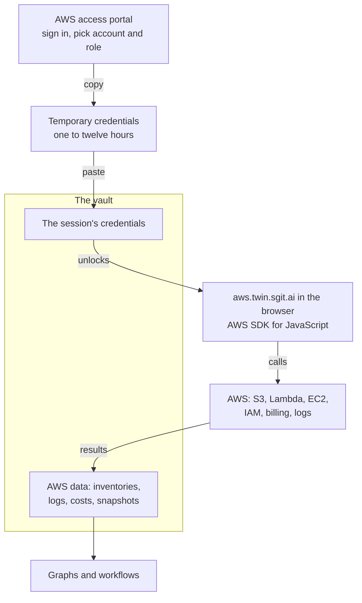
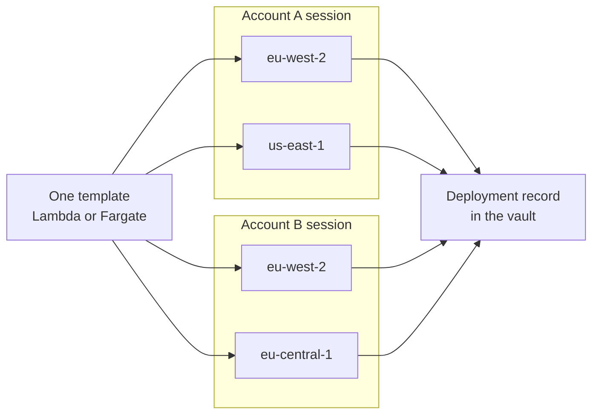

!shot aw-flow.webp | images/ | The proposed flow: AWS temporary credentials pasted into the vault, used by the site, results saved back. | narrow | architecture

## In short {#in-short}

- **A website for managing AWS, all on the client.** aws.twin.sgit.ai, a twin first.
- **The missing piece was the credentials.** Now they go in the user's vault, for one session.
- **They come from the AWS access portal.** Temporary credentials, from one to twelve hours.
- **The browser does the work.** With the normal AWS SDK for JavaScript.
- **The vault is also where the data goes.** Inventories, logs and costs, versioned, ready for graphs.
- **The first job: deploying our server components.** To many regions and many accounts.
- **There may be a PKI way.** IAM Roles Anywhere; to test.
- **It is a proposal.** Nothing here is built yet.

## Two missing pieces {#missing}

I have been building tools for AWS for years. Most of them are in [OSBot-AWS](https://github.com/owasp-sbot/OSBot-AWS), an open source Python library, Apache 2.0, described as "AWS apis and commands for the OWASP Security Bot (OSBot)", with about 1,180 commits. More recently, [SG/Compute](https://sg-compute.sgit.ai/) took the same approach to launch ephemeral environments: in its own words, it "launches an isolated EC2 environment, runs your work, and terminates it."

And I have talked for a long time about what I wanted to do on top of that: graphs of an AWS account, automation of the painful parts, tools that make the cloud easier to see and to manage. What kept it from happening was not the code. It was two missing pieces.

The first was where to put the credentials. A tool that runs in the browser needs an AWS session, and there was no good place in the browser to keep one. The second was where to put the data. Every time we gathered logs, inventories or costs, we had to decide where they lived, and we never really sorted that out.

The vault answers both. Every user now has one, encrypted on their device, versioned, and able to be temporary. It can hold the session for as long as the session lasts, and it can hold what that session finds.

## A twin first {#twin}

The site has a name now: aws.twin.sgit.ai, part of the family at [twins.sgit.ai](https://twins.sgit.ai/). The name carries the design. It is built twin first: an AWS-shaped interface, for S3, Lambda, EC2, IAM, billing and logs, whose backend is a vault. The real connection, the temporary session below, is put in front of it as a second backend behind the same interface. Everything built against the twin then works against the live account, because the code is written against the interface, not the backend.

That is the pattern of the one twin that already works, the S3-compatible vault container, where code using boto3 cannot tell whether it is talking to S3, a vault, disk or memory. It means every part of the site can be built and tested on a vault, with no credentials at all, and every deployment rehearsed before it runs live. The naming, and the rule behind it, are in [plural for the family, singular for the site](/articles/plural-for-the-family-singular-for-the-site.html).

## The workflow {#workflow}

The session comes from the AWS access portal, which is part of IAM Identity Center. AWS describes the difference plainly: "IAM users are granted long-term credentials to AWS resources. Users in IAM Identity Center are granted temporary credentials." It recommends the second, "because these credentials are generated every time you sign in."

So the flow is short:

- **Sign in to the AWS access portal.** Pick the account, and the role you have in it, which IAM Identity Center calls a permission set.
- **Choose "Access keys".** The portal shows the temporary credentials for that role: an access key, a secret key and a session token.
- **Paste them into your vault.** The vault can be a temporary one, made for this session.
- **Work.** For as long as the session lasts, the site can do whatever that role can do.

How long it lasts is set on the permission set: AWS says "This session can be from one to 12 hours", with one hour by default. When it ends, the credentials in the vault are worth nothing, and you sign in again.

That is a deliberate trade. AWS also offers automatic refresh through its CLI. Copying and pasting is a little more work, and in return the site never sees anything but one short-lived session, for one account and one role.

## The browser does the work {#browser}

Once the session is in the vault, everything else runs on the client, with the normal AWS SDK for JavaScript. That is what opens up the long list of things that are painful to do in the AWS console today:

- **An S3 browser.** Buckets, objects, sizes and permissions, the way you want to see them.
- **Lambda functions.** What is deployed, where, at which version, and with which settings.
- **EC2 instances.** What is running, in which regions, and what it costs.
- **Billing.** Where the money goes, by service, by account and over time.
- **IAM.** Who and what can reach which resources.
- **Logs.** Gathered, kept and searched.

On top of those come workflows, built one at a time, in the same way SG/Compute grew its specs: each one a repeatable thing I can run from the browser.

There is one thing to test early. Browsers enforce CORS, and AWS's SDK guide says "Amazon S3 buckets require CORS configuration before you can perform operations on them", and that "CORS is still used for services other than Amazon S3". Which AWS services answer a browser directly, and which do not, is the first thing to measure. Where one does not, a small helper on the user's own machine, or an SG/Compute node, can make that call instead.

## A home for AWS data {#data}

The second piece matters as much as the first. Everything the site gathers, the list of functions, the instances, the costs, the logs, goes back into the vault. Because the vault is versioned, every snapshot is a commit, so you can see what changed in an account between Monday and Friday.

That is what makes graph-based analysis of AWS practical. The resources become nodes; the links between them, a role and its policies, a function and the bucket it reads, an instance and its security group, become edges. It is the same question this site asks of agents in [what can your agent reach?](/articles/what-can-your-agent-reach.html): not only what is there, but what can reach what. And it is the same idea as [knowledge that maintains itself](/articles/knowledge-that-maintains-itself.html): build the graph from the source, then read the slice you need and the diff since you last looked.

## The first job: deploying our servers {#deploy}

!shot aw-deploy.webp | images/ | The first job, as an example: one template deployed through one session per account into several regions. | architecture

The short-term reason I want this is our own deployments. The SG/Send server components, the small API that stores vaults, need to run in many regions and, increasingly, in many accounts. The pieces already exist: CloudFormation templates for Lambda, as a container image with a function URL, and for ECS Fargate, an S3 storage mode with buckets named per account and region, and runbooks for new accounts and regions. What is painful is running them across all of those, and knowing afterwards what is deployed where.

With a session per account, the site can run the same template into each region, and write down every deployment in the vault: which version, which region, which account, when, and what it produced. The vault becomes the record of the estate, and the next deployment starts from it.

## Is there a PKI way? {#pki}

Copying credentials from the portal is good enough to start. But it would be better if the session came from a key, like [everything else now does](/articles/pki-everywhere.html). AWS has a service for exactly that: IAM Roles Anywhere. In AWS's words, it lets you "obtain temporary security credentials in IAM for workloads such as servers, containers, and applications that run outside of AWS", using "X.509 certificates issued by your certificate authority". You register your certificate authority "as a trust anchor to establish trust between your public-key infrastructure (PKI) and IAM Roles Anywhere".

That fits the direction we are going in, with keys made on the device and a register anyone can check. Whether it can work from a browser, signing the request with a key the browser cannot export, and whether its endpoint answers a browser at all, is to test. Its resources are also regional, so a trust anchor is per account and per region.

## What to be careful about {#careful}

- **A session can do whatever its role can do.** So the roles should be narrow: one for reading, another for deploying, never more than the job needs.
- **Short sessions are the default.** One hour, unless there is a reason for more.
- **The site's own code is what holds the session.** So it should be released the way our API sites are, each version a fixed, independent copy, so you know exactly which code you trusted.
- **Credentials never go in a page or a repository.** AWS's own guidance for browser code is "We do not recommend hard coding your AWS credentials in your scripts". Here they are pasted for one session and kept in the vault.
- **Some calls may need a helper.** Where a service will not answer a browser.

## What this does not claim {#limits}

- **Nothing here is built.** The name is decided, aws.twin.sgit.ai, and its repository exists; the site does not yet.
- **Browser access is not tested service by service.** S3 needs CORS; the rest is to measure.
- **IAM Roles Anywhere from a browser is untested.** It is the PKI path to explore.
- **The deployment pieces are in beta.** The templates are written, not a reviewed reference architecture.
- **The quotes are from AWS's documentation.** Read on 21 October 2026.

## The diagrams, as source {#diagrams}

The two diagrams above are Mermaid, rendered for this page. Here is their source, to reuse or correct.

## Where this comes from {#sources}

A voice memo of 21 October 2026. AWS's documentation, read the same day: [getting IAM Identity Center user credentials](https://docs.aws.amazon.com/singlesignon/latest/userguide/howtogetcredentials.html), [what is IAM Roles Anywhere](https://docs.aws.amazon.com/rolesanywhere/latest/userguide/introduction.html), and the AWS SDK for JavaScript's pages on [CORS](https://docs.aws.amazon.com/sdk-for-javascript/v3/developer-guide/cors.html) and [credentials in a browser](https://docs.aws.amazon.com/sdk-for-javascript/v3/developer-guide/setting-credentials-browser.html). [OSBot-AWS](https://github.com/owasp-sbot/OSBot-AWS) on GitHub and [SG/Compute's site](https://sg-compute.sgit.ai/), and [twins.sgit.ai](https://twins.sgit.ai/built/index.html) on the S3 container, read the same day. sgit.ai's [AWS page](https://sgit.ai/partnerships/aws.html), for the templates and runbooks. Related: [plural for the family, singular for the site](/articles/plural-for-the-family-singular-for-the-site.html), [the user keeps the meter](/articles/the-user-keeps-the-meter.html), [PKI everywhere](/articles/pki-everywhere.html), [agent workflows on ephemeral vaults](/articles/agent-workflows-on-ephemeral-vaults.html), [what can your agent reach?](/articles/what-can-your-agent-reach.html), [knowledge that maintains itself](/articles/knowledge-that-maintains-itself.html). Written up and checked by this site's agent, newsroom.writer; the editorial responsibility is mine.
