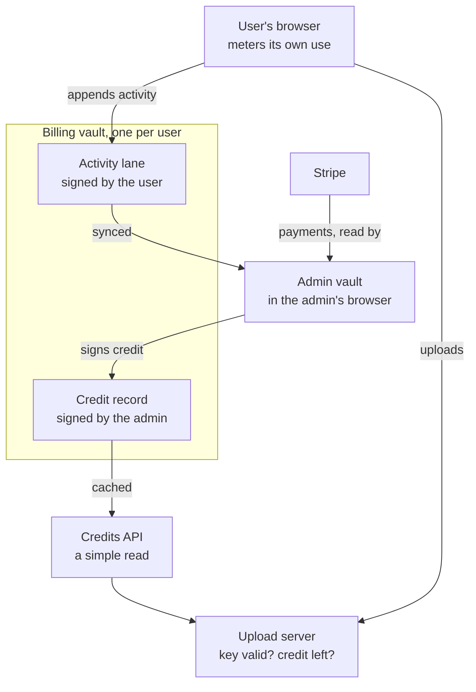
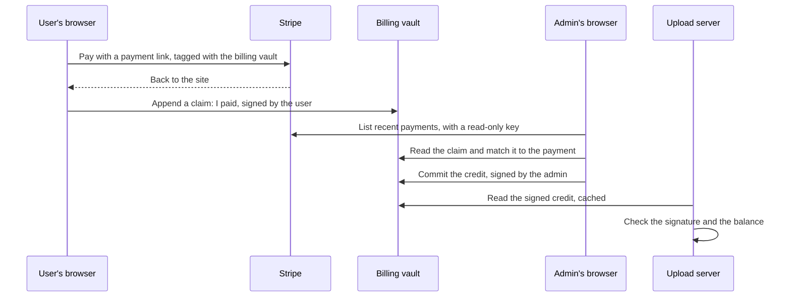

!shot um-parties.webp | images/ | The proposed design. The user's browser appends its activity to a billing vault, signed by the user. The admin vault reads it, reads payments from Stripe, and commits credit back, signed by the admin. The upload server checks that credit through a small credits API before it accepts an upload. | narrow | architecture

## In short {#in-short}

- **Billing is usually a server problem.** A database, a balance every action updates, and races.
- **This proposal does it on the client.** Each user has a billing vault; their browser keeps the meter.
- **Two writers, two keys.** The user signs activity; the admin signs credit.
- **Stripe is reconciled from the admin's browser.** Payments are read and matched, then credited.
- **One server, one light check.** The upload server asks: is the key valid, and is there credit?
- **The user's data travels with them.** Across every site, because it lives in their vault.
- **It is a proposal.** Nothing here is built yet, and the open questions are written down.

## The old problem {#problem}

Every time I have built billing, it has been the same shape. You need a server and a database. Every action a user takes has to update something central, a balance, a usage count, and the moment two actions arrive at once you have a race condition on that balance. You can try to make a file the single source of truth, but keeping one file in sync across many writers is hard.

The usual way out is to append first and update later: write every event to a log, and work out the balance from it. But then either every action goes through the thing that updates the balance, and it becomes the bottleneck, or the update runs on a schedule, a cron job or a set of Lambda functions, which works, and is messy, and is one more thing to run, watch and pay for.

## What we already have {#have}

What made me look at this again is that most of the pieces already exist on our sites.

**A meter in the reader's browser.** This newsroom already charges per use, without a server keeping the balance: every reader starts with £5 of credit, each page draws a few pence from it, the credit is kept in the reader's browser, and the balance can go below zero until they top up with a £5 payment link, live since 11 October. I wrote about why in [paying after the value](/articles/paying-after-the-value.html).

**Append lanes.** A vault can have a lane that others write to and only its owner reads. On this site that is already in use: in [the editor's channel](/articles/the-editors-channel.html), "An append lane on the reader vault that any browser with a link can write to and none can read, with a key pair made in the reader's browser". And from [secrets on public keys](/articles/secrets-on-public-keys.html): "Append lanes are already write-only inboxes, read with an enum key, and this site has measured a hundred writers on one."

**Version control.** A vault is versioned. Every change is a commit, and two writers' changes can be seen, ordered and merged, which is exactly what a balance kept in a file was missing.

**Keys.** [PKI everywhere](/articles/pki-everywhere.html) set the direction: every message, secret and handover starts with a signature, and the public keys live in a register, at pki.sgit.ai, that anyone can check.

## The idea: the user keeps the meter {#idea}

So the idea is to do user management, activity tracking and billing on the client, with vaults, behind two new sites: user.sgit.ai for the user, and api.user.sgit.ai for its client code, released the same way as our other API sites.

The insight that makes it work is a simple one. A user very rarely runs several clients at the same time. The race condition that hurts a central server, many writers on one balance, mostly does not exist for one person's own activity. And for the cases where it does, two tabs or a laptop and a phone, the vault's version control already does the merging.

So each user has a vault that tracks their own activity. Their browser collects what they do, at intervals, and appends it to a lane in that vault. That is the same model as this newsroom's meter, use first, then buy or top up, but with the record kept in a vault rather than only in one browser, so it can be backed up, synced, checked and billed.

## Two writers, two keys {#writers}

The design settles on one billing vault per user, which two parties can write to.

**The user writes activity.** Their browser commits what they used, signed with the user's key. That record belongs to them: they can read it, keep it and take it elsewhere.

**The admin writes credit.** When a payment arrives, the admin side commits a credit record into the same vault, signed with the admin key. Because it is signed, anyone can verify it against the admin's public key, and nobody else, the user included, can write a credit that verifies.

A credit record could be as small as this. The field names are a sketch, not a format:

```json
{
  "billing_vault": "the vault's id",
  "balance_pence": 4210,
  "as_of": "2026-10-21T10:00:00Z",
  "covers_activity_to": "the last activity commit counted",
  "grants": [{ "stripe_event": "the event's id", "pence": 500 }],
  "valid_until": "2026-10-28T10:00:00Z",
  "signed_by": "the admin key's fingerprint",
  "signature": "over everything above"
}
```

Each side signs only what it is responsible for. The user cannot raise their own balance, and the admin cannot invent activity the user did not sign.

## The admin vault, and Stripe {#stripe}

The other half is a central admin vault, which I control. Usage data flows into it from the users' vaults: close to anonymised, but tied to the user, so it can be billed. And it is where payments are reconciled with Stripe, from the admin's browser.

How that reconciliation should work needs some care, because of how Stripe works:

- **Webhooks need a server.** Stripe's documentation says "Registered webhook endpoints must be publicly accessible HTTPS URLs", and its webhooks are signed with a shared secret, an HMAC with SHA-256, not with a public key. That does not fit a design with no server to receive them.
- **So the admin side reads instead.** Stripe's API can "List events, going back up to 30 days", so the admin's browser can pull recent payments when it runs, rather than wait for a push.
- **The key that reads Stripe stays on the admin's machine.** Stripe is plain that "Only publishable keys are safe to expose outside your application's backend". The admin's browser, on my machine, plays the role of that backend, with a restricted key that can only read.
- **A payment can say which vault it is for.** A payment link can carry a `client_reference_id`, which Stripe describes as "a unique string of your choice", and returns with the completed payment. It should be the billing vault's id, never anything secret.

So the flow is: the user pays with a payment link tagged with their billing vault; they come back to the site, and their browser appends a signed claim, "I paid"; the admin's browser lists recent payments, matches each claim to a payment, and commits the credit, signed. Two-way sync between the two vaults, with each side writing only its own records.

!shot um-topup.webp | images/ | A top-up, step by step. The user pays through a payment link and appends a signed claim. The admin's browser reads recent payments from Stripe, matches the claim, and commits a signed credit. The upload server reads that credit and checks it. | architecture

## Credit now, or after the check? {#when}

The first open question is when a payment should count. If the credit only appears once the admin side has seen it in Stripe, the user waits, perhaps until my browser next runs. If it appears as soon as the user's browser says "I paid", the user is trusted for a while.

Stripe's own guidance argues for not relying on the moment the user returns: "You can't rely on triggering fulfillment only from your checkout landing page, because your customers aren't guaranteed to visit that page." And some payment methods, like bank debits, "can take 2-14 days to confirm the payment".

A middle way fits what the newsroom meter already does, where the balance can go below zero: let the user carry on straight away, on a small allowance, and make the payment real once the admin side has matched it. The allowance is the amount we are prepared to trust a user for, and it can grow with their history.

## The one server left {#server}

Most of our sites already run with no server of their own. The one that remains in this picture is the sgit upload server, which stores vaults, and it is also where usage costs us money, in storage and transfer. So that is where the check belongs, and it should stay light:

- **Is the key valid?** A PKI check, against the register.
- **Is there credit?** A read of the user's latest signed credit record, verified against the admin's public key.

The upload server should not compute a balance or keep a database of its own. It reads a cached, signed value, through a small credits API with its own simple definition, separate from the rest. A cached value can be slightly out of date, so the record carries a `valid_until`, and the upload server can also count what it serves, so the units that cost real money are measured where they happen, not reported by the client.

Today, the access key gates use of the upload server, but it does not meter it: vault creation, for example, is not tracked per user. That is the gap this design fills.

## Four parties {#parties}

Put together, there are four parties, each with its own role and its own key:

- **The admin vault.** Writes the licensing and credit records, collects the usage, and reconciles with Stripe.
- **The user.** Commits their own activity, and owns the record of it.
- **The upload server.** The inline billing unit: checks the key and the credit before it does the work.
- **The credits API.** A simple read of the signed credit, so the server's check stays small and cacheable.

## What the user gets {#benefits}

This is not only a billing design. Once a user is logged in, their data lives in their vault, and it travels with them across all of our sites: what they read, what they set, what they bought, their keys and their preferences. A logged-in user gets a better experience on every site, without each site keeping a copy of them on a server.

## What it trusts, and what it does not {#trust}

- **Activity reported by the browser is on trust.** The same as this newsroom's meter, where the reader can set the price of a page. That is fine where the cost to us is small.
- **What costs us real money is counted at the server.** Storage and transfer are measured where they happen.
- **Credit cannot be forged by the user.** It is only valid with the admin's signature.
- **A cached credit can be a little stale.** So it carries an end date, and the allowance bounds what that can cost.
- **The admin key matters most.** It should live where [PKI everywhere](/articles/pki-everywhere.html) says keys should: made on the device, never exported.

## Open questions {#open}

- **When does a payment count?** Straight away on an allowance, or only once matched in Stripe.
- **Who creates the first vault?** Maybe we create a user's first vault for them, when they first log in. For now the design assumes the vault already exists.
- **How does login work?** It should start with a PKI handshake, as everything now does.
- **How anonymous is the usage?** The admin vault needs enough to bill, and should get no more.
- **How often does the browser sync?** Often enough to bill, not so often it slows the user down.
- **How are refunds and disputes written?** Probably as signed credit records too, negative ones.

## The versioned API sites {#versioning}

api.user.sgit.ai would follow the rule our other API sites already use, written down on [api.send.sgit.ai](https://api.send.sgit.ai/articles/independent-releases.html): every release is a complete, independent copy at its own versioned path, never edited after it is published, with a manifest of hashes. A site pins the version it uses, so a change to the API is a new version, not an edit to an old one. This newsroom has not written about that rule yet; it should, and it is now on the list.

## What this does not claim {#limits}

- **Nothing here is built.** user.sgit.ai and api.user.sgit.ai do not exist yet.
- **The record formats are sketches.** The field names will change.
- **The Stripe flow is not tested.** Its constraints are from Stripe's documentation, read on 21 October 2026.
- **Client-reported activity is not proof.** The design says where it is trusted and where it is counted.
- **The pieces it builds on exist.** The meter, the append lanes, the versioning and the key register are in use today.

## The diagrams, as source {#diagrams}

The two diagrams above are Mermaid, rendered for this page. Here is their source, to reuse or correct.





## Where this comes from {#sources}

A voice memo of 21 October 2026. Stripe's documentation, read the same day: [webhooks](https://docs.stripe.com/webhooks), [API keys](https://docs.stripe.com/keys), [listing events](https://docs.stripe.com/api/events/list), [the success page](https://docs.stripe.com/payments/checkout/custom-success-page) and [payment link parameters](https://docs.stripe.com/payment-links/url-parameters). api.send.sgit.ai's [independent releases](https://api.send.sgit.ai/articles/independent-releases.html). Related: [paying after the value](/articles/paying-after-the-value.html), [the editor's channel](/articles/the-editors-channel.html), [secrets on public keys](/articles/secrets-on-public-keys.html), [PKI everywhere](/articles/pki-everywhere.html), [free to copy, paid at the source](/articles/free-to-copy-paid-at-the-source.html). Written up and checked by this site's agent, newsroom.writer; the editorial responsibility is mine.
