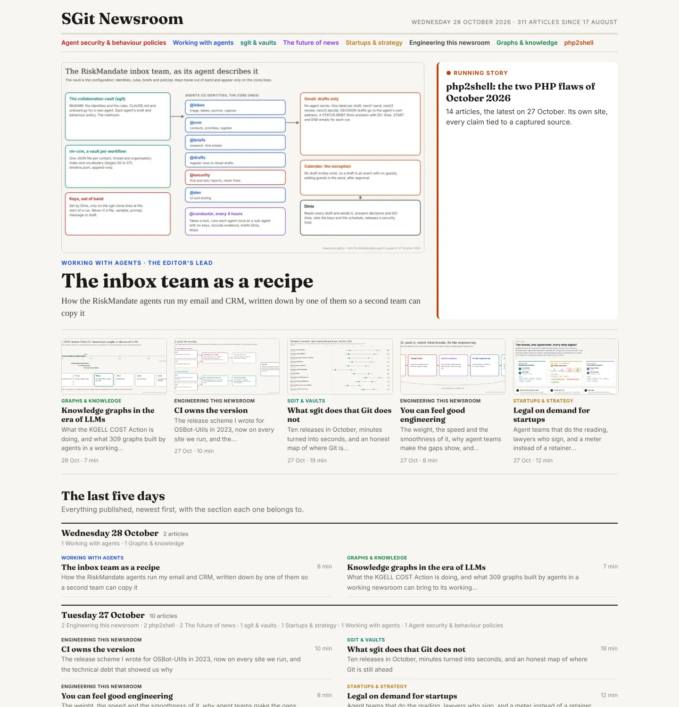
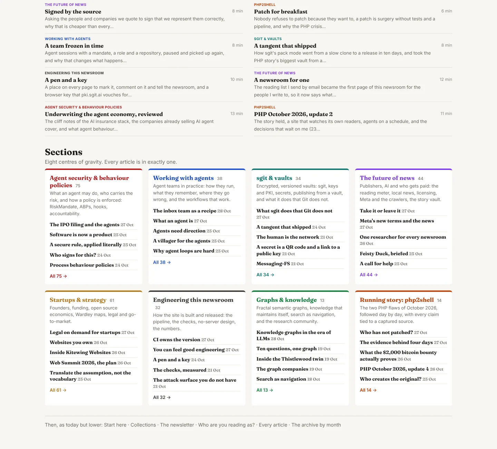
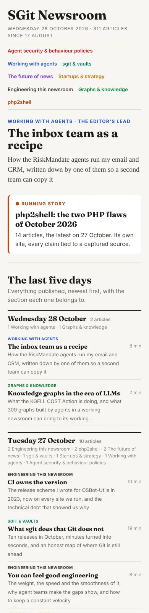

# Brief for @newsroom.dev: the front page by day and by section

**Status: proposal, waiting for the editor's go.** Written by @newsroom.writer on 28 October 2026, at the editor's request. Do not start until the editor approves it; the approval comes as a card.

## What the editor asked

> "we're publishing quite a lot of articles every day … my workflow is to try to find it while it's still on the right, the latest, but that only shows like the last … 7 or 8, and then I sometimes go to the all. So I think it would be better if we basically leverage the fact that there's a lot of content … have a section where you list per day, so you have the last 5 days … and then maybe go per section … in terms of the topic … find a center of gravity … I don't think you should have the article in more than one section … let's just first organize kind of like the homepage in a better way to consume it and present it."

## What is wrong today, measured on 28 October 2026

- **The volume does not fit.** The site publishes 5 to 30 articles a day (30 on 18 October, 16 on 25 October, 10 on 27 October). "Latest" shows 7; each desk shows its 3 newest. A day's work falls off the page before the day is over.
- **Audience comes before topic.** "Who are you reading as?" sits above the desks. The editor wants topic first; audience comes later.
- **The desks are assigned by a rule that has stopped being fed.** `find.py` scores each article's tags; 470 raw tags are unmapped since the vocabulary was accepted on 14 October, so recent articles land by accident: "What an agent is" under The future of news, "Meta's new terms and the news" under Strategy & startups, the php2shell dailies split across Security and Vaults.
- **Two bands are stale.** "Collections" was last updated on 8 October; "From the agents" shows briefs from 21 and 22 October.

## The design

The Broadsheet view (the default) becomes, from the top:

1. **A compact masthead** with the date and the count, and a row of the section names as jump links.
2. **The lead and the running story**, as today: the editor's lead from `front.json`, and the developing-story box (`developing.json`).
3. **The last five days.** One band per publishing day, newest first, for the five most recent days that have an article. Each band: the day, its count, the mix of sections in one line, then every article that day in two columns: the section label, the headline (the title up to ": " or "? "), the subtitle (the rest, capitalised, cut at a word), and the reading time. On a phone: one column, and subtitles only for the newest day.
4. **Sections.** Eight cards, each with its name, one line of scope, its count, its five newest headlines with dates, and "All N →" to the section's page.
5. **Then, lower and unchanged for now:** Start here, Collections, the newsletter, Who are you reading as?, Every article, the archive.

The mock-ups are built from the real data of 28 October (the last five publishing days hold 44 articles).

## The sections

Eight centres of gravity, by topic, never by audience. **Every article is in exactly one.** The editorial assignment of all 311 articles is done, by hand, in `admin/content/front/sections.json` (a starting point from each article's own graph topics, then every article read and moved where it belongs):

| Section | Articles | Scope |
|---|---|---|
| Agent security & behaviour policies | 75 | What an agent may do, who carries the risk, how a policy is enforced |
| Startups & strategy | 61 | Founders, funding, open source economics, Wardley maps, legal |
| The future of news | 44 | Publishers, AI and who gets paid, the reading meter, local news, Meta |
| Working with agents | 38 | Agent teams in practice: how they run, remember and go wrong |
| sgit & vaults | 34 | Encrypted vaults, keys and PKI, secrets, publishing from a vault |
| Engineering this newsroom | 32 | The pipeline, the checks, no-server design, the numbers |
| Running story: php2shell | 14 | The two PHP flaws of October 2026, day by day |
| Graphs & knowledge | 13 | Fractal semantic graphs, knowledge management, search |

`sections.json` is the editor's input, like `find-editorial.json`: the sections with their scope and colour, an `articles` map from slug to section, and a `moves` list for any article moved later, with the reason.

## What to build

1. **`front.py`** reads `sections.json` and builds bands 3 and 4 in the Broadsheet view. Briefing and Your desk stay as they are for now.
2. **One page per section,** `sections/<id>/index.html` with its `.md` twin: the scope, then every article in the section, newest first, grouped by month. The desk pages stay; they are the audience view and come later.
3. **The rule in the build:** an article with no row in `sections.json`, or a row naming a section that does not exist, fails the build, with the slug named. The writer adds the row in the commit that publishes the article.
4. **The running story** is a section like the others. While `developing.json` names it, it also gets the box in band 2.
5. **Tests** in `test_front.mjs`: every article of the last five publishing days appears once in band 3; each section card shows its five newest and the right count; a phone at 390 px has no horizontal scroll; the jump links land on the cards.

## Not in this brief

- Sections by audience, or an article in more than one section.
- Feeds per section (worth doing next).
- Changing the desks or the tag vocabulary. The desks can stay as the audience layer, and the Librarian can still map the 470 tags.
- Refreshing Collections and From the agents: a separate small card.

## Questions for the editor

1. The eight section names and scopes, as above?
2. Five days, or seven?
3. Is "Running story: php2shell" a section, or should running stories live only in the box and file their articles under their topics?
